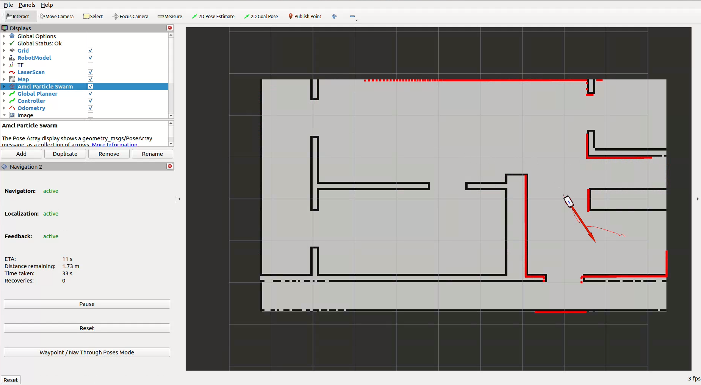
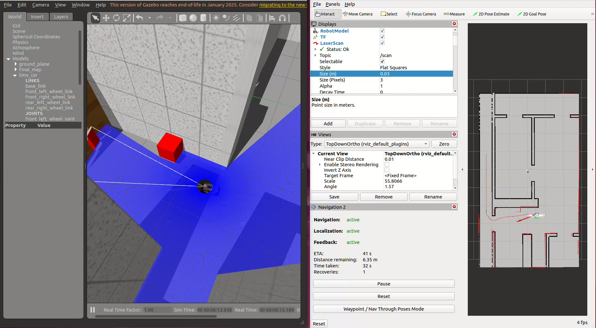

# Autonomous Robot Navigation with ROS 2 and Nav2

**MSc Computer Science coursework (Autonomous Robots), University of Hull**

A complete autonomous navigation pipeline for a simulated **LIMO** robot in **ROS 2 Humble** and **Gazebo**. The robot builds its own map with **SLAM Toolbox**, localises on it with **AMCL**, then drives itself from start to goal with **Nav2**, avoiding walls and a moving obstacle without any manual steering.



---

## What it does

| Stage | How |
|---|---|
| **Mapping** | SLAM Toolbox (asynchronous mode) builds an occupancy grid from the LiDAR. The camera feed is used to check the map while it's being built. |
| **Localisation** | AMCL on the saved map, plus a custom auto-localisation routine (`auto_localize.py`) that triggers global relocalisation and spins the robot so AMCL can converge |
| **Planning** | Nav2 NavFn global planner (A* mode), with DWB as the local controller |
| **Safety** | Layered costmaps (static, obstacle and inflation layers) tuned for clearance, plus Nav2 recovery behaviours |
| **Dynamic obstacles** | A scripted moving box (`dynamic_obstacle.py`) crosses the robot's path during navigation |

## Results

| Test | Outcome |
|---|---|
| Autonomous start-to-goal run | ✅ Reached the goal in **54.6 s** with no manual input |
| Safe-clearance run | ✅ Kept its distance from walls through narrow sections |
| Recovery behaviour | ✅ Re-planned and recovered when blocked or uncertain |
| Dynamic obstacle | ✅ Avoided the moving obstacle with **no collision** |

### Planner comparison: A* vs Dijkstra

The map, start, goal, local controller and safety settings were all kept the same, and only the global search strategy changed:

| | NavFn **A\*** | NavFn Dijkstra |
|---|---|---|
| Time to goal | **54.6 s** | 154.1 s |
| Path directness | High | Moderate |
| Recovery needed | Low | Higher |

In this environment, A*'s goal-directed search produced a much more direct route, so it was used for the final configuration.



## Problems I diagnosed and fixed

- **Distorted map.** Accumulated drift duplicated walls. Slower, overlapping mapping passes produced a clean loop closure.
- **Unreliable localisation at start-up.** Navigating before AMCL had settled caused wrong turns. I added an auto-localisation step that triggers global relocalisation and spins the robot before navigation begins.
- **Corner-cutting and overshoot.** Tuning the DWB controller and costmap inflation stopped the robot clipping corners.

---

## Repository structure

```
limo_car/
  launch/    limo_car_sim (Gazebo + robot), limo_car_slam (mapping), limo_car_nav2 (navigation),
             limo_car_nav2_dynamic (with moving obstacle), limo_car_nav2_smac (alternative planner)
  config/    nav2_params.yaml (final, NavFn A* + DWB), nav2_params_smac_rpp.yaml (Smac + Regulated
             Pure Pursuit alternative), slam_toolbox.yaml
  scripts/   auto_localize.py, set_initial_pose.py, dynamic_obstacle.py, wasd_teleop.py,
             robot_description_publisher.py
  urdf/      LIMO-style robot model (Xacro) with LiDAR and camera
  worlds/    Gazebo assessment world
  maps/      Saved occupancy map used for navigation
  rviz/      RViz configurations for mapping and navigation
docs/        Screenshots and the ROS computation graph
```

## Running it

Requires Ubuntu 22.04, ROS 2 Humble, Gazebo Classic, Nav2 and SLAM Toolbox.

```bash
mkdir -p ~/limo_ws/src && cd ~/limo_ws/src
git clone https://github.com/ha-minh-duc-nguyen/ros2-autonomous-navigation.git
cd ~/limo_ws && colcon build --symlink-install && source install/setup.bash

# 1. Build a map (drive with the WASD teleop in a second terminal)
ros2 launch limo_car limo_car_slam.launch.py
ros2 run limo_car wasd_teleop.py

# 2. Navigate autonomously on the saved map (set a goal with "2D Goal Pose" in RViz)
ros2 launch limo_car limo_car_nav2.launch.py

# 3. Navigation with a moving obstacle
ros2 launch limo_car limo_car_nav2_dynamic.launch.py
```

The ROS computation graph is in [`docs/rosgraph.png`](docs/rosgraph.png).

---

Developed from the module's LIMO starter package (Apache-2.0). I built the mapping and navigation configuration, launch files, scripts, robot model and world for this project.

## Tech stack

ROS 2 Humble · Nav2 · SLAM Toolbox · AMCL · Gazebo · RViz · Python (rclpy) · URDF/Xacro

---

**Ha Minh Duc Nguyen** · [LinkedIn](https://www.linkedin.com/in/ha-minh-duc-nguyen/) · [GitHub](https://github.com/ha-minh-duc-nguyen)
